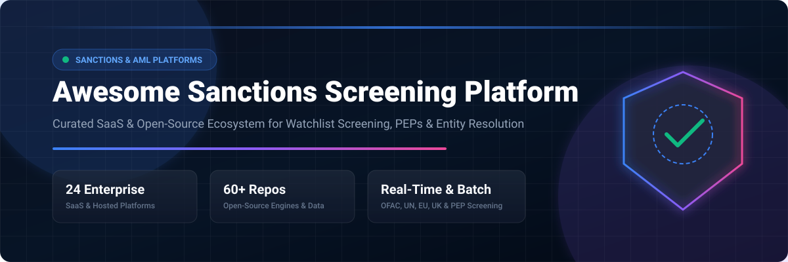

# 🛡️ Awesome Sanctions Screening Platform

<p align="left">
  <a href="https://github.com/ishandutta2007/Awesome-Awesome-Awesome"></a>
  <a href="https://discord.gg/jc4xtF58Ve"></a>
  <a href="https://github.com/ishandutta2007"></a>
</p>

> **Curated List of SaaS/Hosted Platforms & Open-Source GitHub Projects for Sanctions Screening, Watchlist Screening, PEP Screening, AML/KYC, Name Matching, Entity Resolution, Adverse Media & Financial Crime Compliance**

---

## 📌 Executive Overview & SEO Metadata

Modern **Sanctions Screening and Financial Crime Compliance** platforms help institutions screen customers, counterparties, vendors, payments, and blockchain transactions against global regulatory watchlists, politically exposed persons (PEPs), and adverse media.

Key technical capabilities tracked in this ecosystem include:
- 🔍 **Fuzzy Name Matching & Transliteration**: Handling cross-language script transliteration (Arabic, Cyrillic, Chinese, Kanji) and phonetic distance (Double Metaphone, Jaro-Winkler, Levenshtein).
- 🧬 **Entity Resolution & Record Linkage**: Deduplicating entity representations across disparate databases using probabilistic matching and graph structures.
- ⚡ **Real-Time & Batch Screening APIs**: Sub-100ms API response times for payment screening alongside bulk CSV batch screening.
- 📜 **Sanctions Dataset Aggregation**: Ingestion of OFAC SDN, EU Consolidated, UN Security Council, UK OFSI, and regional compliance datasets.
- 🔄 **Continuous Monitoring & Alert Resolution**: Automated ongoing customer monitoring and AI-driven false-positive reduction.

---

## 📚 Table of Contents

- 💼 [SaaS & Hosted Platforms](#-saas--hosted-platforms)
- 🔓 [Open-Source GitHub Projects](#-open-source-github-projects)
- ⚙️ [Open-Source Sanctions Screening Engines](#-open-source-sanctions-screening-engines)
- 🌐 [Open-Source Sanctions Data & Watchlists](#-open-source-sanctions-data--watchlists)
- 🔍 [Open-Source Entity Resolution & Name Matching](#-open-source-entity-resolution--name-matching)
- 🏗️ [Frameworks for Building Custom Sanctions Screening Systems](#-frameworks-for-building-custom-sanctions-screening-systems)
- 📐 [Reference Sanctions Screening Architecture](#-reference-sanctions-screening-architecture)
- 🔄 [Typical Sanctions Screening Workflow](#-typical-sanctions-screening-workflow)
- 📊 [Open-Source Capability Matrix](#-open-source-capability-matrix)
- 📈 [Star History](#-star-history)
- 🤝 [How to Contribute](#-how-to-contribute)
- ⚠️ [Disclaimer](#%EF%B8%8F-disclaimer)

---

## 💼 SaaS & Hosted Platforms

> 📊 **Market Overview**: The global sanctions screening and AML compliance software market is estimated at **$3.8 Billion to $5.2 Billion (2026)** with a ~15.4% CAGR. The sector is **moderately fragmented**, featuring enterprise market concentration among major risk data providers (LexisNexis, LSEG World-Check, Moody's, Dow Jones) alongside a fast-growing ecosystem of specialized, AI-driven challenger SaaS platforms (ComplyAdvantage, Flagright, Unit21, AMLYZE).

| Platform | Description | Starting Tier Pricing | Free Tier / Trial Limit | Company Size (Rev / Valuation) |
| --- | --- | --- | --- | --- |
| [Oracle Watchlist Screening](https://www.oracle.com/financial-services/aml/) | Enterprise watchlist and sanctions screening engine within Oracle Financial Services Suite. | $30,000/year baseline module license | 30-day Oracle Cloud free trial account ($300 cloud credits) | $53B Rev / $380B Mkt Cap |
| [Oracle FCCM](https://www.oracle.com/financial-services/financial-crime-compliance-management/) | Comprehensive Financial Crime & Compliance Management suite covering sanctions, transaction monitoring, KYC & case management. | $50,000/year baseline enterprise platform license | 30-day Oracle Cloud free trial account ($300 cloud credits) | $53B Rev / $380B Mkt Cap |
| [LSEG World-Check](https://www.lseg.com/en/data-analytics/financial-data/risk-intelligence/world-check) | Major global screening database covering sanctions, PEPs, adverse media and risk intelligence. | $5,000/year minimum small business entry package | 14-day trial account for regulated financial institutions | $11B Rev / $65B Mkt Cap (LSEG) |
| [FIS AML Compliance Hub](https://www.fisglobal.com/) | Financial-crime compliance ecosystem supporting AML, sanctions and transaction-monitoring use cases. | $25,000/year minimum SaaS platform subscription | 14-day request-based trial environment | $10B Rev / $40B Mkt Cap |
| [LexisNexis Risk Solutions](https://risk.lexisnexis.com/) | Enterprise risk-information ecosystem covering sanctions, PEPs, identity, fraud, KYC and financial-crime risk. | £8,500/year (~$10,800/year) baseline enterprise contract | 14-day proof-of-concept trial upon sales request (up to 500 test screenings) | $4.8B Rev / $75B Mkt Cap (RELX) |
| [LexisNexis Bridger Insight XG](https://risk.lexisnexis.com/products/bridger-insight-xg) | Sanctions, watchlist and risk-screening solution supporting customer and counterparty screening. | £8,500/year (~$10,800/year) per instance baseline | 14-day proof-of-value trial on request (up to 500 test screenings) | $4.8B Rev / $75B Mkt Cap (RELX) |
| [Moody's Grid](https://www.moodys.com/) | Enterprise risk and compliance data platform supporting sanctions, PEP, ownership, entity and counterparty intelligence. | $6,000/year minimum baseline data package subscription | 14-day request-based trial access for compliance officers | $6.5B Rev / $80B Mkt Cap |
| [SAS Anti-Money Laundering](https://www.sas.com/) | Enterprise AML analytics and compliance platform supporting transaction monitoring, sanctions screening and investigation. | $50,000/year baseline enterprise software license | 30-day SAS Viya trial sandbox access | $3.2B Rev / $15B+ Valuation |
| [NICE Actimize](https://www.niceactimize.com/) | Enterprise financial-crime platform covering AML, sanctions, fraud, transaction monitoring, investigations and compliance operations. | $40,000/year minimum baseline contract | 30-day guided proof-of-concept trial for enterprise clients | $2.4B Rev / $12B Mkt Cap (NICE) |
| [Dow Jones Risk & Compliance](https://www.dowjones.com/professional/risk/) | Enterprise risk and compliance data covering sanctions, PEPs, adverse media, enforcement and ownership information. | $12,000/year minimum starting subscription | 7-day request-based trial for accredited compliance teams | $2.2B Rev / $10B Mkt Cap (News Corp) |
| [Dow Jones RiskCenter](https://www.dowjones.com/professional/risk/) | Dow Jones compliance/risk ecosystem for screening, monitoring and investigative workflows. | $15,000/year minimum platform subscription | 14-day demo trial account upon request | $2.2B Rev / $10B Mkt Cap (News Corp) |
| [Fenergo](https://www.fenergo.com/) | Client lifecycle management and financial-crime compliance platform covering KYC, AML, screening, onboarding and ongoing monitoring. | $35,000/year minimum subscription for SaaS Client Lifecycle Management | 14-day request-based demo trial environment | ~$150M ARR / $1.15B Valuation |
| [ComplyAdvantage](https://complyadvantage.com/) | Global AML and financial-crime platform covering sanctions screening, PEPs, adverse media, transaction monitoring, customer risk and continuous monitoring. | $99/month (billed annually for up to 100 monitored entities) | 12-month free access for early-stage startups via ComplyLaunch program (no general standard free trial) | ~$60M ARR / $600M Valuation |
| [Unit21](https://www.unit21.ai/) | AML, fraud and risk platform providing transaction monitoring, sanctions screening, case management and configurable financial-crime workflows. | $1,500/month ($18,000/year minimum annual contract) | 14-day developer sandbox trial available upon sales request | ~$30M ARR / $300M Valuation |
| [ThetaRay](https://thetaray.com/) | AI-based transaction-monitoring and financial-crime detection platform used for AML, sanctions and payment-risk scenarios. | $2,000/month minimum contract ($25,000/year entry tier) | 30-day trial sandbox for qualified financial institutions | ~$30M ARR / $250M Valuation |
| [Silent Eight](https://www.silenteight.com/) | AI-powered sanctions and financial-crime alert-resolution platform focused on reducing false positives and automating screening investigations. | $20,000/year minimum contract for AI screening resolution | 30-day historical data backtest / proof-of-concept trial | ~$20M ARR / $150M Valuation |
| [Senzing](https://senzing.com/) | Entity-resolution technology used to resolve people and organizations across fragmented datasets and improve AML/KYC screening quality. | $1,000/month minimum for production ($0.05/entity/year) | Free forever for up to 10,000 entities for non-commercial/evaluation use | ~$15M ARR / $100M Valuation |
| [Napier AI](https://www.napier.ai/) | AI-driven compliance platform covering transaction monitoring, sanctions screening, customer risk and financial-crime investigation. | £15,000/year (~$19,000/year) baseline contract (or £1,250/month G-Cloud entry) | 30-day proof-of-concept sandbox trial upon request | ~$15M ARR / $80M Valuation |
| [Sanction Scanner](https://www.sanctionscanner.com/) | AML/KYC platform providing sanctions, PEP and adverse-media screening, transaction monitoring and risk management. | €150/month (~$165/month) for Starter Plan (up to 1,000 checks/month) | 14-day free trial with 50 free screening credits | ~$8M ARR / $45M Valuation |
| [AMLYZE](https://www.amlyze.com/) | AML compliance platform covering transaction monitoring, sanctions screening, case management, risk scoring and configurable financial-crime workflows. | €200/month (~$220/month) for Basic Plan (up to 500 entity screenings/month) | 14-day free trial with 100 free screening credits | ~$5M ARR / $30M Valuation |
| [Flagright](https://www.flagright.com/) | Real-time AML compliance platform covering transaction monitoring, sanctions screening, case management and risk controls. | $250/month Starter tier (includes up to 2,500 monthly screenings) | Free tier forever for early-stage startups (up to 1,000 API calls/month) or 14-day full free trial | ~$4M ARR / $25M Valuation |
| [AMLBot](https://amlbot.com/) | AML/KYT screening platform focused particularly on crypto and blockchain addresses, transaction risk and sanctions-related compliance. | $15/month for Starter Package (includes 35 checks) or $0.40/check | 5 free check credits upon account registration | ~$3M ARR / $20M Valuation |
| [NameScan](https://namescan.io/) | Online AML screening service focused on sanctions, PEP and watchlist screening. | $15 for 50-credit Starter Pack (~$0.30/check) or $0.10/check for volume packages | 5 free check credits upon account registration | ~$2M ARR / $12M Valuation |
| [AML Partners](https://amlpartners.com/) | AML compliance technology covering screening, transaction monitoring, case management and financial-crime workflows. | $1,200/month ($14,400/year minimum annual contract) | 14-day interactive demo trial upon request | ~$2M ARR / $10M Valuation |

---

## 🔓 Open-Source GitHub Projects

> ⭐️ **Sorted by GitHub_Stars (Descending)**

* **[n8n](https://github.com/n8n-io/n8n)** [](https://github.com/n8n-io/n8n/stargazers)

  Workflow automation platform for integrating screening APIs & alerts.

* **[Elasticsearch](https://github.com/elastic/elasticsearch)** [](https://github.com/elastic/elasticsearch/stargazers)

  Distributed search & analytics engine widely used for sanctions name indexing.

* **[Meilisearch](https://github.com/meilisearch/meilisearch)** [](https://github.com/meilisearch/meilisearch/stargazers)

  Ultra-fast open-source search engine with built-in typo tolerance.

* **[Twenty](https://github.com/twentyhq/twenty)** [](https://github.com/twentyhq/twenty/stargazers)

  Modern open-source CRM with customer onboarding & compliance data tracking.

* **[Odoo](https://github.com/odoo/odoo)** [](https://github.com/odoo/odoo/stargazers)

  Open-source ERP platform supporting customer master data & KYC compliance.

* **[Apache Airflow](https://github.com/apache/airflow)** [](https://github.com/apache/airflow/stargazers)

  Data pipeline orchestration framework for sanctions dataset ingestion.

* **[Milvus](https://github.com/milvus-io/milvus)** [](https://github.com/milvus-io/milvus/stargazers)

  Cloud-native vector database for AI-driven entity resolution.

* **[Apache Spark](https://github.com/apache/spark)** [](https://github.com/apache/spark/stargazers)

  Unified analytics engine for large-scale enterprise batch screening.

* **[DuckDB](https://github.com/duckdb/duckdb)** [](https://github.com/duckdb/duckdb/stargazers)

  In-process analytical database engine ideal for fast local screening.

* **[ERPNext](https://github.com/frappe/erpnext)** [](https://github.com/frappe/erpnext/stargazers)

  Open-source ERP system with built-in customer verification capabilities.

* **[Qdrant](https://github.com/qdrant/qdrant)** [](https://github.com/qdrant/qdrant/stargazers)

  Vector search engine for semantic entity matching & vector embeddings.

* **[Prefect](https://github.com/prefecthq/prefect)** [](https://github.com/prefecthq/prefect/stargazers)

  Workflow management system for resilient compliance data pipelines.

* **[Airbyte](https://github.com/airbytehq/airbyte)** [](https://github.com/airbytehq/airbyte/stargazers)

  Data integration platform for syncing sanctions & watchlist sources.

* **[ZincSearch](https://github.com/zincsearch/zincsearch)** [](https://github.com/zincsearch/zincsearch/stargazers)

  Lightweight alternative search engine for logs & entity search.

* **[Dagster](https://github.com/dagster-io/dagster)** [](https://github.com/dagster-io/dagster/stargazers)

  Data orchestrator for machine-learning & data engineering compliance pipelines.

* **[Great Expectations](https://github.com/great-expectations/great_expectations)** [](https://github.com/great-expectations/great_expectations/stargazers)

  Data quality validation framework for sanctions dataset integrity.

* **[OpenCTI](https://github.com/OpenCTI-Platform/opencti)** [](https://github.com/OpenCTI-Platform/opencti/stargazers)

  Open cyber threat & entity intelligence platform.

* **[FuzzyWuzzy](https://github.com/seatgeek/fuzzywuzzy)** [](https://github.com/seatgeek/fuzzywuzzy/stargazers)

  Classic fuzzy string matching in Python using Levenshtein distance.

* **[MISP](https://github.com/MISP/MISP)** [](https://github.com/MISP/MISP/stargazers)

  Open-source threat & compliance intelligence sharing platform.

* **[Dedupe](https://github.com/dedupeio/dedupe)** [](https://github.com/dedupeio/dedupe/stargazers)

  Machine-learning record linkage & entity resolution library.

* **[RapidFuzz](https://github.com/rapidfuzz/RapidFuzz)** [](https://github.com/rapidfuzz/RapidFuzz/stargazers)

  High-performance fuzzy string matching library in C++ / Python.

* **[TheHive](https://github.com/TheHive-Project/TheHive)** [](https://github.com/TheHive-Project/TheHive/stargazers)

  Security incident response & compliance case management platform.

* **[Apache Lucene](https://github.com/apache/lucene)** [](https://github.com/apache/lucene/stargazers)

  High-performance search engine library providing foundation for sanctions search.

* **[Frappe CRM](https://github.com/frappe/crm)** [](https://github.com/frappe/crm/stargazers)

  Open-source CRM with extensible entity management & compliance integration.

* **[Splink](https://github.com/moj-analytical-services/splink)** [](https://github.com/moj-analytical-services/splink/stargazers)

  Fast probabilistic record linkage & deduplication at scale.

* **[DFIR-IRIS](https://github.com/dfir-iris/iris-web)** [](https://github.com/dfir-iris/iris-web/stargazers)

  Incident response platform adaptable for compliance case management.

* **[recordlinkage](https://github.com/J535D165/recordlinkage)** [](https://github.com/J535D165/recordlinkage/stargazers)

  Python record linkage toolkit for data matching & deduplication.

* **[OpenSanctions](https://github.com/opensanctions/opensanctions)** [](https://github.com/opensanctions/opensanctions/stargazers)

  Open database & ETL pipeline for sanctions, PEPs & entities of interest.

* **[nomenklatura](https://github.com/opensanctions/nomenklatura)** [](https://github.com/opensanctions/nomenklatura/stargazers)

  Entity integration, deduplication & data lineage infrastructure.

* **[yente](https://github.com/opensanctions/yente)** [](https://github.com/opensanctions/yente/stargazers)

  Open-source entity matching API & search engine behind OpenSanctions.

* **[FollowTheMoney](https://github.com/opensanctions/followthemoney)** [](https://github.com/opensanctions/followthemoney/stargazers)

  Data model and entity framework for investigation & sanctions data.

* **[rigour](https://github.com/opensanctions/rigour)** [](https://github.com/opensanctions/rigour/stargazers)

  Data-cleaning & normalization library for names, territories & identifiers.

* **[zavod](https://github.com/opensanctions/zavod)** [](https://github.com/opensanctions/zavod/stargazers)

  Data ingestion & crawler framework for public watchlists.

* **[ekkis/ofac](https://github.com/ekkis/ofac)** [](https://github.com/ekkis/ofac/stargazers)

  Node.js module for local OFAC SDN searching & alias matching.

* **[OFAC SDN API](https://github.com/qvapay/ofac-sdn)** [](https://github.com/qvapay/ofac-sdn/stargazers)

  Lightweight HTTP API for screening names against OFAC SDN list.

* **[yente-client](https://github.com/opensanctions/yente-client)** [](https://github.com/opensanctions/yente-client/stargazers)

  Python SDK, CLI & MCP server for yente matching engine.

* **[jeffallen13/ofac](https://github.com/jeffallen13/ofac)** [](https://github.com/jeffallen13/ofac/stargazers)

  Historical OFAC list dataset & temporal analysis tools.

* **[OFAC Screening API](https://github.com/Suixcity/ofac-screening)** [](https://github.com/Suixcity/ofac-screening/stargazers)

  FastAPI-based self-hosted OFAC screening API with daily list sync.

* **[sanctions-pep-screening](https://github.com/userenigmatic/sanctions-pep-screening)** [](https://github.com/userenigmatic/sanctions-pep-screening/stargazers)

  Streamlit & RapidFuzz reference application for sanctions & PEP screening.

* **[Sanction Shield](https://github.com/JerrettDavis/sanction-shield)** [](https://github.com/JerrettDavis/sanction-shield/stargazers)

  Fuzzy-matching sanctions screening REST API designed for SMB compliance.

* **[super-simple-sanctions](https://github.com/TBD54566975/super-simple-sanctions)** [](https://github.com/TBD54566975/super-simple-sanctions/stargazers)

  Lightweight sanctions matching reference engine by TBD54566975.

* **[sanctions-checker](https://github.com/TBD54566975/sanctions-checker)** [](https://github.com/TBD54566975/sanctions-checker/stargazers)

  Archived lightweight sanctions checker reference implementation.

---

## ⚙️ Open-Source Sanctions Screening Engines

The open-source sanctions-screening ecosystem centers on self-hosted matching APIs and modular screening components:

* **[OpenSanctions + yente](https://github.com/opensanctions/yente)** [](https://github.com/opensanctions/yente/stargazers)
  Production-grade entity matching API using query-by-example for multi-attribute matching across global sanctions lists.

* **[Sanction Shield](https://github.com/JerrettDavis/sanction-shield)** [](https://github.com/JerrettDavis/sanction-shield/stargazers)
  Lightweight FastAPI sanctions-screening service with CSV batch upload & audit logs.

* **[OFAC Screening API](https://github.com/Suixcity/ofac-screening)** [](https://github.com/Suixcity/ofac-screening/stargazers)
  Focused OFAC list screening API with automated daily list synchronization & HubSpot workflow support.

* **[OFAC SDN API](https://github.com/qvapay/ofac-sdn)** [](https://github.com/qvapay/ofac-sdn/stargazers)
  Lightweight serverless-friendly API for screening names against the OFAC SDN registry.

---

## 📐 Reference Sanctions Screening Architecture

```text
[ Incoming Transaction / Customer Onboarding ]
                       │
                       ▼
         [ Normalization & Cleaning ]
        (Transliteration & Phonetics)
                       │
                       ▼
       [ High-Speed Index Search / Match Engine ]
     (Elasticsearch / OpenSanctions yente / Splink)
                       │
             ┌─────────┴─────────┐
             ▼                   ▼
    [ Match Score >= Threshold ]  [ Match Score < Threshold ]
             │                   │
             ▼                   ▼
    [ Alert Generation & ]     [ Auto Pass / Approved ]
    [ Case Management   ]
```

---

## 📊 Open-Source Capability Matrix

| Capability | Recommended Open-Source Tool / Library | Key Strength |
| --- | --- | --- |
| **Sanctions Data Pipeline** | [OpenSanctions](https://github.com/opensanctions/opensanctions) | Automated ETL from 40+ global sources into FollowTheMoney format |
| **Matching API** | [yente](https://github.com/opensanctions/yente) | Self-hostable Docker container with REST & reconciliation API |
| **Probabilistic Linkage** | [Splink](https://github.com/moj-analytical-services/splink) | Scalable entity resolution powered by DuckDB & Spark |
| **String Fuzzy Matching** | [RapidFuzz](https://github.com/rapidfuzz/RapidFuzz) | High-speed C++ implementation of Levenshtein & token metrics |
| **Case Management** | [TheHive](https://github.com/TheHive-Project/TheHive) / [DFIR-IRIS](https://github.com/dfir-iris/iris-web) | Analyst review workflows & evidence tracking |

---

## 📈 Star History

[](https://star-history.dera.page/#ishandutta2007/Awesome-Sanctions-Screening-Platform&type=date&legend=top-left)

---

## 🤝 How to Contribute

Contributions are welcome! If you know of notable SaaS platforms or open-source sanctions-screening tools, please submit a pull request:
1. Fork the repository.
2. Add your tool with factual descriptions and links.
3. Ensure open-source entries include proper GitHub repo links.
4. Submit a Pull Request!

---

## ⚠️ Disclaimer

This curated list is provided for educational, informational, and research purposes only. Sanctions compliance requires strict adherence to regulatory standards across applicable jurisdictions (OFAC, EU, UN, UK OFSI, etc.). Always verify licensing and data freshness before using any software or dataset in production.
