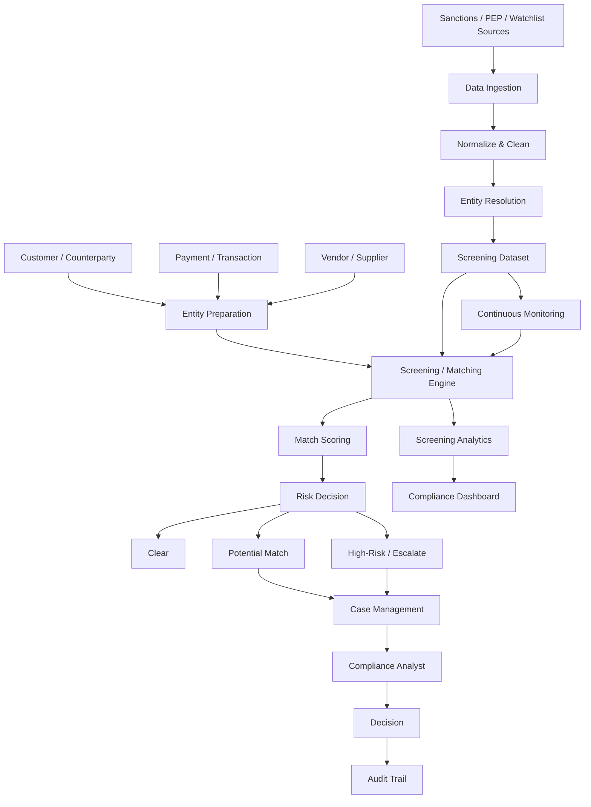
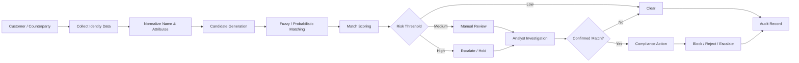
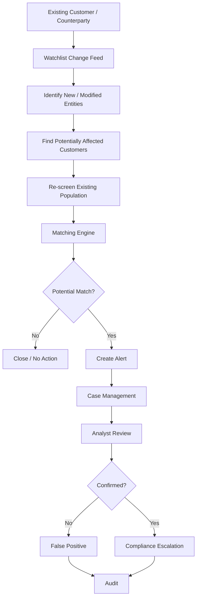
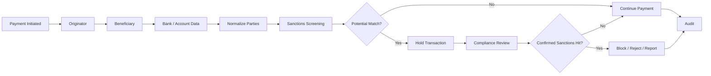

# Awesome-Sanctions-Screening-Platform

## Top Sanctions Screening Platform Ecosystem


**Curated List of SaaS/Hosted Platforms & Open-Source GitHub Projects**

*Focused on Sanctions Screening, Watchlist Screening, PEP Screening, AML/KYC, Name Matching, Entity Resolution, Adverse Media, Transaction Screening, Continuous Monitoring & Financial Crime Compliance*

**Last updated: September 2026**


This repository tracks notable **SaaS/Hosted platforms** and **open-source projects** for **Sanctions Screening and Watchlist Management**. These systems help organizations screen customers, counterparties, vendors, payments and transactions against sanctions, politically exposed persons (PEPs), regulatory watchlists and other risk datasets.


**Examples** include ComplyAdvantage, LexisNexis Risk Solutions, Dow Jones Risk & Compliance, Refinitiv World-Check, AMLBot, Sanction Scanner, Unit21, Flagright, Napier AI, ThetaRay, LexisNexis Bridger, Dow Jones RiskCenter, Oracle Watchlist Screening, Fenergo, Moody's Grid, AML Partners, Silent Eight, AMLYZE, Oracle FCCM, NICE Actimize and NameScan.


Modern sanctions-screening platforms increasingly combine **fuzzy name matching, transliteration, entity resolution, aliases, identifiers, sanctions-list ingestion, PEP screening, adverse media, ownership structures, risk scoring, transaction screening, continuous monitoring, alert generation, case management, analyst review and audit trails**.


**Open-source emphasis**: Genuine open-source sanctions-screening software is much smaller than the commercial market. The most important project is the **[OpenSanctions](https://github.com/opensanctions/opensanctions)** ecosystem, which provides an open-source data pipeline, entity model and associated matching infrastructure. Its **[yente](https://github.com/opensanctions/yente)** engine provides API-based entity matching and can be self-hosted. OpenSanctions also maintains **[yente-client](https://github.com/opensanctions/yente-client)**, **[FollowTheMoney](https://github.com/opensanctions/followthemoney)**, **[nomenklatura](https://github.com/opensanctions/nomenklatura)**, **[rigour](https://github.com/opensanctions/rigour)** and **[zavod](https://github.com/opensanctions/zavod)** as open-source building blocks.


OpenSanctions' **software is MIT licensed**, but its published datasets have separate licensing terms, including CC BY-NC 4.0 for certain data and third-party source restrictions. Therefore, organizations should **not assume that open-source code automatically means unrestricted commercial use of sanctions data**.


There is currently **no single open-source platform with complete feature parity with enterprise products such as World-Check, ComplyAdvantage, Bridger or NICE Actimize**. A production-grade open-source solution is normally assembled from:


**Sanctions Data + Entity Resolution + Fuzzy Matching + Screening Engine + Risk Scoring + Case Management + Continuous Monitoring + Audit Trail**


Contributions welcome! Open a PR to add/update entries. Keep descriptions factual and clearly distinguish **complete screening platforms**, **screening engines**, **sanctions datasets**, **entity-resolution libraries** and **AML building blocks**.


## Table of Contents


* [SaaS/Hosted Platforms](#saashosted-platforms)

* [Open-Source GitHub Projects](#open-source-github-projects)

* [Open-Source Sanctions Screening Engines](#open-source-sanctions-screening-engines)

* [Open-Source Sanctions Data & Watchlists](#open-source-sanctions-data--watchlists)

* [Open-Source Entity Resolution & Name Matching](#open-source-entity-resolution--name-matching)

* [Open-Source AML/KYC Platforms](#open-source-amlkyc-platforms)

* [Open-Source Case Management & Investigation](#open-source-case-management--investigation)

* [Open-Source Transaction Monitoring & Fraud](#open-source-transaction-monitoring--fraud)

* [Open-Source Data & Search Infrastructure](#open-source-data--search-infrastructure)

* [Open-Source Analytics & Risk Dashboards](#open-source-analytics--risk-dashboards)

* [Open-Source Workflow & Automation](#open-source-workflow--automation)

* [Additional Strong Open-Source Options](#additional-strong-open-source-options)

* [Commercial Sanctions Screening → Open-Source Equivalents](#commercial-sanctions-screening--open-source-equivalents)

* [Frameworks for Building Custom Sanctions Screening Systems](#frameworks-for-building-custom-sanctions-screening-systems)

* [Reference Sanctions Screening Architecture](#reference-sanctions-screening-architecture)

* [Typical Sanctions Screening Workflow](#typical-sanctions-screening-workflow)

* [Continuous Monitoring Workflow](#continuous-monitoring-workflow)

* [Open-Source Data Model](#open-source-data-model)

* [Open-Source Capability Matrix](#open-source-capability-matrix)

* [Recommended Open-Source Stacks](#recommended-open-source-stacks)

* [What Is Still Difficult to Reproduce in Open Source?](#what-is-still-difficult-to-reproduce-in-open-source)

* [Why Open Source Is Interesting](#why-open-source-is-interesting)

* [How to Contribute](#how-to-contribute)

* [Disclaimer](#disclaimer)


## SaaS/Hosted Platforms


* **[ComplyAdvantage](https://complyadvantage.com/)**

  Global AML and financial-crime platform covering sanctions screening, PEPs, adverse media, transaction monitoring, customer risk and continuous monitoring.


* **[LexisNexis Risk Solutions](https://risk.lexisnexis.com/)**

  Enterprise risk-information ecosystem covering sanctions, PEPs, identity, fraud, KYC and financial-crime risk.


* **[LexisNexis Bridger Insight XG](https://risk.lexisnexis.com/products/bridger-insight-xg)**

  Sanctions, watchlist and risk-screening solution supporting customer and counterparty screening.


* **[Dow Jones Risk & Compliance](https://www.dowjones.com/professional/risk/)**

  Enterprise risk and compliance data covering sanctions, PEPs, adverse media, enforcement and ownership information.


* **[Dow Jones RiskCenter](https://www.dowjones.com/professional/risk/)**

  Dow Jones compliance/risk ecosystem for screening, monitoring and investigative workflows.


* **[LSEG World-Check](https://www.lseg.com/en/data-analytics/financial-data/risk-intelligence/world-check)**

  Major global screening database covering sanctions, PEPs, adverse media and other risk intelligence.


* **[AMLBot](https://amlbot.com/)**

  AML/KYT screening platform focused particularly on crypto and blockchain addresses, transaction risk and sanctions-related compliance.


* **[Sanction Scanner](https://www.sanctionscanner.com/)**

  AML/KYC platform providing sanctions, PEP and adverse-media screening, transaction monitoring and risk management.


* **[Unit21](https://www.unit21.ai/)**

  AML, fraud and risk platform providing transaction monitoring, sanctions screening, case management and configurable financial-crime workflows.


* **[Flagright](https://www.flagright.com/)**

  Real-time AML compliance platform covering transaction monitoring, sanctions screening, case management and risk controls.


* **[Napier AI](https://www.napier.ai/)**

  AI-driven compliance platform covering transaction monitoring, sanctions screening, customer risk and financial-crime investigation.


* **[ThetaRay](https://thetaray.com/)**

  AI-based transaction-monitoring and financial-crime detection platform used for AML, sanctions and payment-risk scenarios.


* **[Oracle Watchlist Screening](https://www.oracle.com/financial-services/aml/)**

  Oracle Financial Services compliance technology supporting watchlist and sanctions screening.


* **[Oracle FCCM](https://www.oracle.com/financial-services/financial-crime-compliance-management/)**

  Financial Crime and Compliance Management suite covering sanctions screening, transaction monitoring, KYC, investigations and regulatory workflows.


* **[Fenergo](https://www.fenergo.com/)**

  Client lifecycle management and financial-crime compliance platform covering KYC, AML, screening, onboarding and ongoing monitoring.


* **[Moody's Grid](https://www.moodys.com/)**

  Enterprise risk and compliance data platform supporting sanctions, PEP, ownership, entity and counterparty intelligence.


* **[AML Partners](https://amlpartners.com/)**

  AML compliance technology covering screening, transaction monitoring, case management and financial-crime workflows.


* **[Silent Eight](https://www.silenteight.com/)**

  AI-powered sanctions and financial-crime alert-resolution platform focused on reducing false positives and automating screening investigations.


* **[AMLYZE](https://www.amlyze.com/)**

  AML compliance platform covering transaction monitoring, sanctions screening, case management, risk scoring and configurable financial-crime workflows.


* **[NICE Actimize](https://www.niceactimize.com/)**

  Enterprise financial-crime platform covering AML, sanctions, fraud, transaction monitoring, investigations and compliance operations.


* **[NameScan](https://namescan.io/)**

  Online AML screening service focused on sanctions, PEP and watchlist screening.


* **[FIS AML Compliance Hub](https://www.fisglobal.com/)**

  Financial-crime compliance ecosystem supporting AML, sanctions and transaction-monitoring use cases.


* **[SAS Anti-Money Laundering](https://www.sas.com/)**

  Enterprise AML analytics and compliance platform supporting transaction monitoring, sanctions screening and investigation.


* **[Senzing](https://senzing.com/)**

  Entity-resolution technology used to resolve people and organizations across fragmented datasets and improve AML/KYC screening quality.


## Open-Source GitHub Projects


### OpenSanctions


**[OpenSanctions](https://github.com/opensanctions/opensanctions)** is the most important open-source ecosystem in this category.


It provides an open database and software stack for sanctions, PEPs and other entities of interest.


Key capabilities include:


* Sanctions datasets

* PEP datasets

* Entity ingestion

* Data normalization

* Deduplication

* Entity linking

* Source tracking

* Data lineage

* Structured exports

* Screening infrastructure

* Custom dataset generation


The software pipeline is MIT licensed, while individual datasets have separate licensing terms. ([OpenSanctions](https://github.com/opensanctions/opensanctions))


### yente


**[yente](https://github.com/opensanctions/yente)** is the matching API behind the OpenSanctions screening ecosystem.


It supports:


* Entity search

* Entity matching

* People

* Companies

* Sanctions

* PEPs

* Watchlists

* Batch matching

* Reconciliation API

* Self-hosted deployments


The matching API uses a **query-by-example** model in which a person or organization is described using multiple attributes and ranked candidates are returned. ([OpenSanctions](https://www.opensanctions.org/docs/api/matching/))


### yente-client


**[yente-client](https://github.com/opensanctions/yente-client)** provides:


* Python SDK

* CLI

* Batch screening

* API integration

* MCP server

* Self-hosted yente support


It can screen people, companies and other entities against sanctions, PEP and watchlist datasets. ([GitHub](https://github.com/opensanctions/yente-client))


### FollowTheMoney


**[FollowTheMoney](https://github.com/opensanctions/followthemoney)** provides the entity and relationship data model underlying the OpenSanctions ecosystem.


It is useful for representing:


* People

* Companies

* Organizations

* Ownership

* Directorships

* Relationships

* Addresses

* Identifiers

* Sanctions

* Political roles


### Nomenklatura


**[Nomenklatura](https://github.com/opensanctions/nomenklatura)** provides entity integration and deduplication infrastructure with data lineage.


It is particularly relevant for:


* Entity resolution

* Deduplication

* Identity matching

* Data integration

* Relationship-aware entity management


### Rigour


**[Rigour](https://github.com/opensanctions/rigour)** provides data-cleaning and normalization tools useful for:


* Names

* Territories

* Identifiers

* Dates

* Structured fields

* Normalization


### Zavod


**[Zavod](https://github.com/opensanctions/zavod)** is the OpenSanctions data-ingestion/crawling toolkit.


It is useful when building a custom watchlist ingestion pipeline from public sources.


## Open-Source Sanctions Screening Engines


### OpenSanctions + yente


The strongest general-purpose open-source combination is:


**OpenSanctions → yente → Screening API → Custom Case Management**


The official documentation supports screening through `/match`, searching sanctions-specific datasets and running the matching service on infrastructure controlled by the deploying organization. ([OpenSanctions](https://www.opensanctions.org/docs/))


### Sanction Shield


**[Sanction Shield](https://github.com/JerrettDavis/sanction-shield)** is a newer open-source sanctions-screening application designed for SMB use cases.


It provides:


* REST API

* Single-name screening

* Batch CSV screening

* Fuzzy matching

* Confidence scores

* Match bands

* Audit-oriented results

* OFAC SDN support

* JSON/CSV output


It is particularly interesting as a compact reference implementation for a self-hosted sanctions-screening API.


### OFAC Screening API


**[ofac-screening](https://github.com/Suixcity/ofac-screening)** provides a self-hosted OFAC screening API.


It includes:


* OFAC list synchronization

* Fuzzy name matching

* Transliteration

* Configurable thresholds

* FastAPI

* REST API

* Daily ingestion

* HubSpot workflow integration


It is MIT licensed and is particularly useful as a focused **OFAC-only screening reference implementation**.


### OFAC SDN API


**[ofac-sdn](https://github.com/qvapay/ofac-sdn)** provides a lightweight HTTP API for screening names against the OFAC SDN list.


It provides:


* Ranked matches

* Confidence scores

* Name matching

* Alias matching

* Optional additional watchlists

* Serverless-friendly deployment


### OFAC Node.js Module


**[ekkis/ofac](https://github.com/ekkis/ofac)** is an older Node.js module for local OFAC SDN searches.


It demonstrates:


* Local sanctions-list loading

* Name searching

* Alias matching

* Identifier searches

* Country-aware searches


It is useful as a small reference project rather than a modern enterprise screening platform.


### Sanctions & PEP Screening Demo


**[sanctions-pep-screening](https://github.com/userenigmatic/sanctions-pep-screening)** demonstrates:


* OFAC screening

* PEP-style screening

* Name normalization

* Fuzzy matching

* RapidFuzz

* Streamlit UI

* Customer-vs-sanctions matching

* Threshold-based review


This is useful as an educational/reference implementation.


### Simple Sanctions Screening


The **[super-simple-sanctions](https://github.com/TBD54566975/super-simple-sanctions)** project is another useful reference for lightweight sanctions screening. It evolved from the archived **[sanctions-checker](https://github.com/TBD54566975/sanctions-checker)** project.


## Open-Source Sanctions Data & Watchlists


Open-source screening is not only about the matching engine. **Data acquisition and freshness are equally important.**


### OpenSanctions


**[OpenSanctions](https://github.com/opensanctions/opensanctions)** aggregates sanctions, PEP and related entity data from multiple public sources.


### OFAC


The U.S. Treasury publishes official sanctions datasets that can be consumed programmatically.


A custom system can retrieve and normalize:


* SDN

* Consolidated sanctions lists

* Country-specific programs

* Entity aliases

* Identifiers

* Addresses

* Vessel information


### OFAC Research Projects


**[jeffallen13/ofac](https://github.com/jeffallen13/ofac)** provides historical OFAC sanctions-list data for research and temporal analysis.


It should not be confused with a production screening engine.


### EU Sanctions


European Union sanctions data can be ingested into custom screening systems and normalized into an internal entity schema.


### UN Security Council


United Nations Security Council consolidated sanctions lists can also form part of a multi-jurisdiction screening dataset.


### UK Sanctions


UK sanctions datasets can be integrated into a custom multi-list screening pipeline.


### OFSI


UK Office of Financial Sanctions Implementation data can be included as a jurisdiction-specific sanctions source.


> **Important:** Public availability of a sanctions list does not automatically mean unrestricted commercial redistribution. Always check the source's current terms and usage requirements.


## Open-Source Entity Resolution & Name Matching


Entity resolution is arguably the most important technical component after sanctions data.


### Splink


**[Splink](https://github.com/moj-analytical-services/splink)** is a powerful open-source probabilistic record-linkage framework.


It supports:


* Fuzzy matching

* Probabilistic linkage

* Deduplication

* Name matching

* Multiple fields

* Term-frequency adjustments

* DuckDB

* Spark

* Athena

* Large-scale datasets


It is highly suitable for building advanced sanctions matching pipelines. ([GitHub](https://github.com/moj-analytical-services/splink))


### RapidFuzz


**[RapidFuzz](https://github.com/rapidfuzz/RapidFuzz)** provides high-performance fuzzy string matching.


Useful algorithms include:


* Levenshtein

* Ratio

* WRatio

* Token similarity

* Partial matching


### Dedupe


**[Dedupe](https://github.com/dedupeio/dedupe)** is an open-source Python library for entity resolution and record linkage.


It is useful for:


* Customer deduplication

* Entity matching

* Organization matching

* Identity resolution


### Record Linkage Toolkit


**[recordlinkage](https://github.com/J535D165/recordlinkage)** provides tools for record linkage and entity-resolution workflows in Python.


### FuzzyWuzzy


**[FuzzyWuzzy](https://github.com/seatgeek/fuzzywuzzy)** is an older fuzzy string-matching library. For new implementations, RapidFuzz is generally the more attractive modern option.


### Apache Lucene


**[Apache Lucene](https://github.com/apache/lucene)** provides advanced search capabilities that can form the foundation of scalable candidate generation.


### Elasticsearch


**[Elasticsearch](https://github.com/elastic/elasticsearch)** can support:


* Candidate retrieval

* Fuzzy queries

* Search-as-you-type

* Phonetic matching

* Synonyms

* Weighted search

* Large watchlist indexes


## Open-Source AML/KYC Platforms


Sanctions screening normally sits inside a larger AML/KYC architecture.


### OpenKYC


Open-source KYC projects can provide:


* Customer onboarding

* Identity records

* Document information

* Screening triggers

* Risk assessment


These should generally be treated as **building blocks**, not substitutes for mature enterprise AML platforms.


### ERPNext


**[ERPNext](https://github.com/frappe/erpnext)** can provide:


* Customers

* Suppliers

* Accounts

* Transactions

* Addresses

* Contacts

* Audit information


It can therefore act as a source system feeding a sanctions engine.


### Odoo


**[Odoo](https://github.com/odoo/odoo)** provides CRM/ERP customer and supplier data that can be screened against sanctions/watchlists.


### Frappe CRM


**[Frappe CRM](https://github.com/frappe/crm)** can provide an open-source CRM source for customer and counterparty screening.


### Twenty


**[Twenty](https://github.com/twentyhq/twenty)** can provide customer/company/contact records to a screening engine.


## Open-Source Case Management & Investigation


A sanctions-screening engine should not automatically treat every fuzzy match as a confirmed sanctions hit.


A production system needs:


**Potential Match → Analyst Review → Decision → Evidence → Audit**


### TheHive


**[TheHive](https://github.com/TheHive-Project/TheHive)** provides open-source security investigation and case-management capabilities.


It can be adapted as an investigation layer around screening alerts.


### DFIR-IRIS


**[DFIR-IRIS](https://github.com/dfir-iris/iris-web)** provides collaborative investigation and case management.


Although designed for digital forensics and incident response, its workflow model can be adapted to certain compliance-investigation scenarios.


### OpenCTI


**[OpenCTI](https://github.com/OpenCTI-Platform/opencti)** provides an open-source knowledge-management platform for threat intelligence.


Its graph-oriented model can be useful when building broader risk-intelligence relationships around:


* People

* Companies

* Organizations

* Events

* Relationships


### MISP


**[MISP](https://github.com/MISP/MISP)** is primarily a threat-intelligence sharing platform rather than a sanctions engine, but its structured data-sharing architecture can inspire or support risk-intelligence workflows.


## Open-Source Transaction Monitoring & Fraud


Sanctions screening increasingly needs to operate alongside transaction monitoring.


Useful components include:


### Apache Flink


**[Apache Flink](https://github.com/apache/flink)** can provide real-time event processing for transaction screening.


### Apache Kafka


**[Apache Kafka](https://github.com/apache/kafka)** can act as the transaction-event bus.


### Apache Spark


**[Apache Spark](https://github.com/apache/spark)** can provide large-scale batch analysis.


### River


**[River](https://github.com/online-ml/river)** provides online machine-learning algorithms useful for streaming risk scoring.


### PyOD


**[PyOD](https://github.com/yzhao062/pyod)** provides anomaly-detection algorithms useful for transaction-risk analysis.


### scikit-learn


**[scikit-learn](https://github.com/scikit-learn/scikit-learn)** provides classical machine-learning algorithms for:


* Risk scoring

* Classification

* Anomaly detection

* Clustering


## Open-Source Data & Search Infrastructure


A scalable screening engine can use:


### PostgreSQL


**[PostgreSQL](https://github.com/postgres/postgres)**


Useful for:


* Customers

* Counterparties

* Screening results

* Cases

* Decisions

* Audit logs

* Risk scores


### OpenSearch


**[OpenSearch](https://github.com/opensearch-project/OpenSearch)**


Useful for:


* Full-text matching

* Fuzzy search

* Candidate generation

* Screening analytics

* Alert search

* Audit investigation


### Elasticsearch


**[Elasticsearch](https://github.com/elastic/elasticsearch)**


Useful for high-volume candidate retrieval and fuzzy search.


### Redis


**[Redis](https://github.com/redis/redis)**


Useful for:


* Screening caches

* Session state

* Rate limiting

* Temporary screening results


### DuckDB


**[DuckDB](https://github.com/duckdb/duckdb)**


Useful for:


* Watchlist analytics

* Batch screening

* Historical screening analysis

* Large CSV/Parquet datasets


### MinIO


**[MinIO](https://github.com/minio/minio)**


Useful for self-hosted object storage for:


* Watchlist snapshots

* Evidence

* Screening reports

* Audit exports


## Open-Source Analytics & Risk Dashboards


### Grafana


**[Grafana](https://github.com/grafana/grafana)** can visualize:


* Screening volumes

* Potential matches

* False-positive rates

* Analyst workloads

* Alert aging

* Match scores

* List changes

* Screening latency

* Risk distributions


### Metabase


**[Metabase](https://github.com/metabase/metabase)** provides self-service compliance analytics.


### Apache Superset


**[Apache Superset](https://github.com/apache/superset)** provides advanced dashboards for sanctions and AML analytics.


### OpenSearch Dashboards


**[OpenSearch Dashboards](https://github.com/opensearch-project/OpenSearch-Dashboards)** can provide search and investigation interfaces.


## Open-Source Workflow & Automation


### Temporal


**[Temporal](https://github.com/temporalio/temporal)** is highly suitable for durable screening workflows:


* Screening

* Re-screening

* Analyst review

* Escalation

* Case closure

* Periodic monitoring

* Evidence collection


### Apache Airflow


**[Apache Airflow](https://github.com/apache/airflow)** can orchestrate:


**Data Source → Normalize → Match → Score → Review → Report**


### Dagster


**[Dagster](https://github.com/dagster-io/dagster)** can manage data-aware sanctions ingestion pipelines.


### Prefect


**[Prefect](https://github.com/PrefectHQ/prefect)** can schedule and monitor screening pipelines.


### n8n


**[n8n](https://github.com/n8n-io/n8n)** can connect screening workflows with:


* CRM

* ERP

* Email

* Slack

* Databases

* Case-management systems

* Webhooks


### Node-RED


**[Node-RED](https://github.com/node-red/node-red)** can provide low-code workflow orchestration for screening events and integrations.


## Additional Strong Open-Source Options


* **[OpenSanctions](https://github.com/opensanctions/opensanctions)** — open sanctions/PEP data ecosystem.

* **[yente](https://github.com/opensanctions/yente)** — entity matching and screening API.

* **[yente-client](https://github.com/opensanctions/yente-client)** — Python SDK, CLI and MCP server.

* **[FollowTheMoney](https://github.com/opensanctions/followthemoney)** — entity/relationship data model.

* **[Nomenklatura](https://github.com/opensanctions/nomenklatura)** — entity integration and deduplication.

* **[Rigour](https://github.com/opensanctions/rigour)** — data normalization.

* **[Zavod](https://github.com/opensanctions/zavod)** — sanctions-data ingestion toolkit.

* **[Sanction Shield](https://github.com/JerrettDavis/sanction-shield)** — self-hosted sanctions-screening API.

* **[ofac-screening](https://github.com/Suixcity/ofac-screening)** — OFAC screening API.

* **[ofac-sdn](https://github.com/qvapay/ofac-sdn)** — lightweight OFAC SDN API.

* **[ekkis/ofac](https://github.com/ekkis/ofac)** — local OFAC search library.

* **[sanctions-pep-screening](https://github.com/userenigmatic/sanctions-pep-screening)** — fuzzy sanctions/PEP demo.

* **[super-simple-sanctions](https://github.com/TBD54566975/super-simple-sanctions)** — lightweight sanctions screening.

* **[Splink](https://github.com/moj-analytical-services/splink)** — probabilistic entity resolution.

* **[RapidFuzz](https://github.com/rapidfuzz/RapidFuzz)** — high-performance fuzzy matching.

* **[Dedupe](https://github.com/dedupeio/dedupe)** — entity resolution.

* **[recordlinkage](https://github.com/J535D165/recordlinkage)** — record-linkage toolkit.

* **[Apache Lucene](https://github.com/apache/lucene)** — search/indexing engine.

* **[OpenSearch](https://github.com/opensearch-project/OpenSearch)** — search and analytics.

* **[PostgreSQL](https://github.com/postgres/postgres)** — relational database.

* **[DuckDB](https://github.com/duckdb/duckdb)** — analytical database.

* **[Kafka](https://github.com/apache/kafka)** — event streaming.

* **[Flink](https://github.com/apache/flink)** — real-time processing.

* **[TheHive](https://github.com/TheHive-Project/TheHive)** — case management.

* **[DFIR-IRIS](https://github.com/dfir-iris/iris-web)** — investigation/case-management platform.

* **[OpenCTI](https://github.com/OpenCTI-Platform/opencti)** — graph-based intelligence platform.

* **[MISP](https://github.com/MISP/MISP)** — structured intelligence sharing.

* **[Temporal](https://github.com/temporalio/temporal)** — durable workflow engine.

* **[Airflow](https://github.com/apache/airflow)** — workflow orchestration.

* **[Grafana](https://github.com/grafana/grafana)** — compliance analytics.

* **[Metabase](https://github.com/metabase/metabase)** — self-service BI.

* **[Superset](https://github.com/apache/superset)** — analytics and dashboards.

* **[Frappe CRM](https://github.com/frappe/crm)** — open-source CRM.

* **[ERPNext](https://github.com/frappe/erpnext)** — ERP/customer/counterparty data source.

* **[Odoo](https://github.com/odoo/odoo)** — ERP/CRM source system.

* **[Twenty](https://github.com/twentyhq/twenty)** — open-source CRM.

* **[PyOD](https://github.com/yzhao062/pyod)** — anomaly detection.

* **[River](https://github.com/online-ml/river)** — online machine learning.

* **[scikit-learn](https://github.com/scikit-learn/scikit-learn)** — machine learning.


## Commercial Sanctions Screening → Open-Source Equivalents


| Commercial Platform             | Primary Focus                            | Strong Open-Source Equivalents / Building Blocks                 |

| ------------------------------- | ---------------------------------------- | ---------------------------------------------------------------- |

| **ComplyAdvantage**             | Sanctions + PEP + adverse media + AML    | OpenSanctions + yente + Splink + OpenSearch                      |

| **LexisNexis Risk Solutions**   | Global risk intelligence                 | OpenSanctions + FollowTheMoney + yente + entity-resolution stack |

| **Dow Jones Risk & Compliance** | Sanctions + PEP + adverse media          | OpenSanctions + OpenCTI + custom data pipelines                  |

| **LSEG World-Check**            | Global sanctions/PEP screening           | OpenSanctions + yente + Splink + PostgreSQL                      |

| **AMLBot**                      | Crypto AML/KYT + sanctions               | OpenSanctions + blockchain analytics APIs + yente                |

| **Sanction Scanner**            | AML/sanctions/PEP                        | OpenSanctions + yente + Temporal + OpenSearch                    |

| **Unit21**                      | AML + transaction monitoring + screening | Kafka + Flink + OpenSanctions + yente + case management          |

| **Flagright**                   | Real-time AML + screening                | Kafka + Flink + OpenSanctions + yente + Temporal                 |

| **Napier AI**                   | AI AML + transaction monitoring          | OpenSanctions + PyOD + River + Kafka + OpenSearch                |

| **ThetaRay**                    | AI transaction monitoring                | Flink + Kafka + River + PyOD + OpenSanctions                     |

| **LexisNexis Bridger**          | Watchlist screening                      | OpenSanctions + yente + RapidFuzz + PostgreSQL                   |

| **Dow Jones RiskCenter**        | Risk/compliance intelligence             | OpenSanctions + FollowTheMoney + OpenCTI                         |

| **Oracle Watchlist Screening**  | Enterprise watchlist screening           | yente + OpenSanctions + OpenSearch + PostgreSQL                  |

| **Fenergo**                     | CLM/KYC + AML                            | Frappe CRM + OpenSanctions + yente + workflow engine             |

| **Moody's Grid**                | Risk/entity intelligence                 | OpenSanctions + FollowTheMoney + Nomenklatura                    |

| **AML Partners**                | AML workflows                            | OpenSanctions + yente + Temporal + TheHive                       |

| **Silent Eight**                | AI alert resolution                      | yente + Splink + RapidFuzz + custom ML                           |

| **AMLYZE**                      | AML/sanctions + transaction monitoring   | OpenSanctions + Kafka + Flink + OpenSearch                       |

| **Oracle FCCM**                 | Enterprise financial-crime compliance    | OpenSanctions + Kafka/Flink + TheHive + PostgreSQL               |

| **NICE Actimize**               | Enterprise AML/fraud/sanctions           | OpenSanctions + Flink + Kafka + PyOD + case management           |

| **NameScan**                    | Sanctions/PEP screening                  | OpenSanctions + yente + RapidFuzz                                |


> **Important:** These are **capability-oriented mappings**, not feature-for-feature replacements. Commercial platforms generally provide proprietary data, continuously maintained lists, extensive entity resolution, global coverage, regulatory content, enterprise integrations, case management, support and compliance expertise that must be recreated separately in an open-source architecture.


## Frameworks for Building Custom Sanctions Screening Systems


A practical open-source screening stack can be assembled using:


| Layer              | Open-Source Technologies                         |

| ------------------ | ------------------------------------------------ |

| Sanctions Data     | OpenSanctions · OFAC · EU · UN · UK/OFSI sources |

| Data Ingestion     | Zavod · Airflow · Dagster · Prefect              |

| Data Model         | FollowTheMoney                                   |

| Entity Integration | Nomenklatura                                     |

| Normalization      | Rigour                                           |

| Screening API      | yente                                            |

| SDK / CLI          | yente-client                                     |

| Fuzzy Matching     | RapidFuzz                                        |

| Entity Resolution  | Splink · Dedupe · recordlinkage                  |

| Search             | OpenSearch · Elasticsearch · Lucene              |

| Database           | PostgreSQL                                       |

| Analytics          | DuckDB · Polars · Pandas                         |

| Event Streaming    | Kafka · NATS                                     |

| Stream Processing  | Flink                                            |

| Batch Processing   | Spark                                            |

| Risk Scoring       | scikit-learn · River · PyOD                      |

| Case Management    | TheHive · DFIR-IRIS                              |

| Intelligence Graph | OpenCTI · FollowTheMoney                         |

| Workflow           | Temporal · Airflow · Dagster · Prefect           |

| Automation         | n8n · Node-RED                                   |

| Dashboards         | Grafana · Metabase · Superset                    |

| Object Storage     | MinIO                                            |

| Cache              | Redis                                            |

| Authentication     | Keycloak · Authentik                             |

| Deployment         | Docker · Kubernetes                              |

| Monitoring         | Prometheus · Grafana                             |


## Reference Sanctions Screening Architecture





## Typical Sanctions Screening Workflow





## Continuous Monitoring Workflow





## Payment / Transaction Screening Workflow





## Entity Resolution Pipeline


The quality of sanctions screening depends heavily on the ability to determine whether:


**"Mohamed Al Hassan"**


is the same person as:


**"Muhammad Al-Hasan"**


or:


**"Mohammed Hassan"**


A modern open-source architecture should therefore perform:


```text

Raw Name

   ↓

Unicode Normalization

   ↓

Transliteration

   ↓

Case / Punctuation Normalization

   ↓

Tokenization

   ↓

Alias Expansion

   ↓

Candidate Generation

   ↓

Fuzzy Matching

   ↓

Multi-Attribute Comparison

   ↓

Entity Resolution

   ↓

Risk Score

```


Useful technologies include:


**Rigour + RapidFuzz + Splink + yente + OpenSearch**


## Matching Attributes


A robust screening system should compare more than names.


### Person


* Full name

* First name

* Middle name

* Last name

* Alias

* Date of birth

* Place of birth

* Nationality

* Citizenship

* Passport

* National ID

* Address

* Country

* Gender


### Organization


* Legal name

* Trading name

* Former name

* Alias

* Registration number

* LEI

* Tax ID

* Address

* Country

* Directors

* Owners

* Parent company

* Subsidiaries


### Vessel


* Vessel name

* IMO number

* Flag

* Former name

* Call sign

* Owner

* Operator


## Fuzzy Matching Architecture


A strong screening engine should not rely on one similarity algorithm.


A multi-stage architecture can be:


**Candidate Generation → Name Similarity → Alias Similarity → Identifier Match → Country Match → DOB Match → Ownership Match → Composite Score**


For example:


| Signal                     | Importance |

| -------------------------- | ---------: |

| Exact identifier           |  Very High |

| Exact date of birth        |  Very High |

| Exact registration number  |  Very High |

| Exact alias                |       High |

| Name similarity            |       High |

| Transliteration similarity |       High |

| Country                    |     Medium |

| Address                    |     Medium |

| Organization relationship  |     Medium |

| Phonetic similarity        |     Medium |


This approach generally produces better screening quality than simply setting a single fuzzy-string threshold.


## False Positive Reduction


False positives are one of the largest operational problems in sanctions screening.


An open-source implementation can combine:


**RapidFuzz + Splink + yente + rules + analyst feedback**


to distinguish:


* Exact match

* Strong potential match

* Weak potential match

* False positive

* Confirmed sanctions hit


Possible suppression rules include:


* Verified date-of-birth mismatch

* Country mismatch

* Identifier mismatch

* Legal-entity mismatch

* Known customer alias

* Previously adjudicated false positive

* Strongly distinguishing address


These rules must be carefully governed because excessive suppression can create dangerous false negatives.


## Screening Decision Model


A practical architecture can produce:


| Score     | Decision        | Typical Action          |

| --------- | --------------- | ----------------------- |

| Very Low  | Clear           | Continue                |

| Low       | Clear           | Continue                |

| Medium    | Review          | Analyst review          |

| High      | Potential Match | Hold/escalate           |

| Very High | Strong Match    | Immediate investigation |


Thresholds should **not** be copied blindly from another implementation. They should be validated against the organization's data, risk appetite, regulatory requirements and false-positive/false-negative tradeoffs.


## Open-Source Data Model


A serious sanctions platform should model at least the following entities.


### Person


* Person ID

* Name

* Aliases

* DOB

* Nationality

* Country

* Passport

* National ID

* Address

* Risk tags

* Source


### Organization


* Organization ID

* Legal name

* Trading name

* Former names

* Registration number

* LEI

* Country

* Address

* Owners

* Directors

* Parent

* Subsidiaries


### Watchlist Entry


* Entry ID

* Source

* Dataset

* Program

* Entity type

* Name

* Aliases

* Identifiers

* Addresses

* Countries

* Date added

* Date modified

* Source URL


### Screening Request


* Request ID

* Customer ID

* Timestamp

* Entity type

* Input attributes

* Dataset version

* Screening policy

* Threshold


### Match


* Match ID

* Screening request

* Watchlist entry

* Score

* Match features

* Match reason

* Dataset

* Confidence

* Status


### Case


* Case ID

* Alert

* Analyst

* Priority

* Status

* Decision

* Reason

* Evidence

* Created date

* Closed date


### Audit Event


* Event ID

* User

* Timestamp

* Action

* Previous status

* New status

* Evidence

* Dataset version

* Screening policy version


## Data Lineage


For regulatory-grade screening, it is important to know:


**Which data was used?**


**When was it downloaded?**


**Which version was screened?**


**Which algorithm was used?**


**What threshold was applied?**


**Who made the final decision?**


A useful lineage chain is:


```text

Source

  ↓

Dataset Version

  ↓

Normalized Entity

  ↓

Screening Request

  ↓

Matching Algorithm Version

  ↓

Match Score

  ↓

Alert

  ↓

Analyst Decision

  ↓

Compliance Action

```


OpenSanctions explicitly provides data-pipeline tooling and data lineage capabilities through its associated open-source components.


## Recommended Open-Source Stacks


### #1 — General-Purpose Sanctions Screening


**OpenSanctions + yente + PostgreSQL + OpenSearch + Grafana**


Best starting point for a self-hosted screening service.


### #2 — Advanced Entity Resolution


**OpenSanctions + yente + Splink + RapidFuzz + PostgreSQL**


Best when false positives and complex name matching are major concerns.


### #3 — Enterprise AML Architecture


**OpenSanctions + yente + Kafka + Flink + PostgreSQL + OpenSearch + Temporal**


Suitable for high-volume payment and transaction screening.


### #4 — Compliance Investigation Platform


**OpenSanctions + yente + TheHive + OpenSearch + Grafana**


Suitable for organizations wanting an open-source screening + investigation workflow.


### #5 — Graph-Based Risk Intelligence


**OpenSanctions + FollowTheMoney + Nomenklatura + OpenCTI + PostgreSQL**


Useful for relationship-aware investigations involving:


* Ownership

* Directors

* Companies

* Sanctioned entities

* Affiliates

* Related parties


### #6 — Lightweight OFAC Screening


**OFAC Data + RapidFuzz + FastAPI + PostgreSQL**


Suitable for a small, focused OFAC screening service.


### #7 — AI-Assisted Screening


**OpenSanctions + yente + Splink + RapidFuzz + scikit-learn/PyTorch + OpenSearch**


Can support:


* False-positive prediction

* Alert prioritization

* Analyst assistance

* Risk scoring

* Entity-resolution improvements


## Sanctions Data Pipeline


A production system should not simply download a list once.


Recommended architecture:


```text

Government / Regulatory Sources

        ↓

Scheduled Crawlers

        ↓

Raw Data Archive

        ↓

Parser

        ↓

Normalization

        ↓

Entity Resolution

        ↓

Deduplication

        ↓

Versioned Dataset

        ↓

Search Index

        ↓

Screening API

```


The **Zavod + FollowTheMoney + Nomenklatura + yente** combination is particularly interesting for this architecture.


## Screening Performance


A high-volume screening service should optimize:


* Candidate generation

* Indexing

* Batch matching

* Parallel processing

* Cache usage

* Database access

* Search latency

* Entity normalization

* Result storage


For example:


**OpenSearch candidate generation → RapidFuzz/Splink scoring → yente-style matching → PostgreSQL result storage**


can separate fast candidate retrieval from more expensive entity-resolution calculations.


## What Is Still Difficult to Reproduce in Open Source?


The open-source ecosystem is strong in **software infrastructure**, but several areas remain difficult:


* Global sanctions-data coverage

* Continuously maintained commercial datasets

* Proprietary PEP databases

* Proprietary adverse-media databases

* Global enforcement datasets

* Commercial entity-resolution models

* Historical data completeness

* Beneficial-ownership intelligence

* Global corporate hierarchies

* Multilingual name intelligence

* Transliteration quality across all languages

* Commercial risk scoring

* Regulatory content

* Expert-curated aliases

* Global adverse-media monitoring

* Real-time data updates

* Enterprise SLAs

* Regulatory support

* Managed false-positive reduction

* Global customer support

* Production implementation services


This is why the **software side of sanctions screening can be open source while the highest-value commercial differentiation remains in curated data, entity intelligence and compliance content**.


## Open-Source vs Commercial Data


This distinction is critical.


### Open-Source Software


Examples:


* OpenSanctions software

* yente

* Splink

* RapidFuzz

* OpenSearch

* PostgreSQL

* Kafka

* Flink

* Temporal


### Open / Public Data


Examples:


* OFAC lists

* UN sanctions lists

* EU sanctions information

* UK/OFSI information

* Other government watchlists


### Commercial Data


Examples:


* World-Check

* Dow Jones Risk & Compliance

* LexisNexis Risk Solutions

* Moody's Grid

* ComplyAdvantage proprietary datasets


A company can therefore build an **open-source screening engine** while purchasing licensed data feeds where necessary.


## Why Open Source Is Interesting


Open-source sanctions screening can provide:


* Full source-code access

* Self-hosting

* Data residency

* Private-cloud deployment

* Custom matching logic

* Custom thresholds

* Custom risk scoring

* Custom workflow

* No proprietary API lock-in

* Custom integrations

* Local language support

* Custom audit trails

* Transparent algorithms

* Easier testing

* Custom case-management workflows

* Integration with open-source AML infrastructure

* Greater control over screening history

* Easier integration with internal risk systems


It is particularly attractive for:


* Fintechs

* Banks

* Payment companies

* Crypto businesses

* Marketplaces

* Export/import companies

* Insurance companies

* Corporate compliance teams

* RegTech developers

* Government organizations

* Research institutions


## Best Open-Source Starting Points


### #1 — OpenSanctions + yente


**Best overall open-source foundation.**


Use when you need:


* Sanctions

* PEPs

* Watchlists

* Entity matching

* API screening

* Self-hosting


### #2 — Splink


**Best for advanced entity resolution.**


Use when:


* Customer names are noisy

* Multiple datasets need joining

* False positives are expensive

* Large-scale matching is required


### #3 — RapidFuzz


**Best lightweight fuzzy-matching component.**


Use when building a focused screening service.


### #4 — Sanction Shield


**Best compact modern screening application/reference implementation.**


Useful for understanding how a standalone screening API can expose scoring, batches and review-oriented decisions.


### #5 — OFAC Screening API


**Best focused OFAC reference architecture.**


Useful when only U.S. Treasury sanctions screening is required.


### #6 — FollowTheMoney + Nomenklatura


**Best for relationship-aware entity intelligence.**


Useful for organizations wanting to move beyond simple name matching.


## Overall Open-Source Recommendation


For a serious modern open-source alternative to **ComplyAdvantage, World-Check, Bridger, Dow Jones RiskCenter, Oracle Watchlist Screening and similar platforms**, the strongest architecture is:


**OpenSanctions + yente + Splink + RapidFuzz + OpenSearch + PostgreSQL + Temporal + Grafana**


with:


**Sanctions Data → Normalize → Entity Resolution → Candidate Generation → Matching → Risk Score → Alert → Case → Analyst Decision → Audit**


For broader financial-crime compliance:


**OpenSanctions + yente + Kafka + Flink + TheHive + OpenSearch + Grafana**


provides a strong foundation for:


* Sanctions screening

* PEP screening

* Continuous monitoring

* Transaction screening

* Entity resolution

* Case management

* Auditability

* Analytics


The OpenSanctions ecosystem is particularly significant because it does not only provide a dataset: its open-source software stack includes **data ingestion, normalization, entity modeling, data integration and matching components**, allowing organizations to build their own screening infrastructure rather than merely consuming a commercial screening API.


## Important Compliance Considerations


A sanctions-screening system should be designed around the organization's actual regulatory obligations.


Important considerations include:


* OFAC sanctions

* OFAC 50 Percent Rule

* UN sanctions

* EU sanctions

* UK sanctions

* Local national sanctions

* PEP screening

* Beneficial ownership

* Adverse media

* Transaction screening

* Continuous monitoring

* Record keeping

* Alert investigation

* False-positive management

* Screening frequency

* Risk-based thresholds

* Auditability

* Data retention

* Privacy

* Data residency

* Access control

* Model governance


A technically accurate fuzzy matcher is **not by itself a complete sanctions-compliance program**.


## How to Contribute


1. Fork the repo.

2. Add/edit entries in `README.md` following the existing format.

3. Include the official website or GitHub repository.

4. Clearly identify whether the project is **SaaS/Hosted**, **Open Source**, **Open Data**, or an **open-source building block**.

5. Include license information when known.

6. Prefer actively maintained repositories.

7. Distinguish screening engines from sanctions datasets.

8. Identify whether the project supports sanctions, PEP, adverse media, transaction monitoring or entity resolution.

9. Add new watchlist ingestion projects.

10. Add new open-source matching algorithms.

11. Include meaningful AML/KYC case-management projects.

12. Submit a PR with a short explanation.


Star the repo if you find it useful!


## Disclaimer


* This is a **community-curated** list — not exhaustive and not an endorsement.

* Commercial products and trademarks belong to their respective owners.

* Open-source projects listed here are not necessarily feature-for-feature replacements for commercial sanctions-screening platforms.

* Some projects are complete screening applications; others are matching engines, datasets, data pipelines, CRM/ERP systems, case-management platforms or infrastructure components.

* **Open-source software and open sanctions data are not the same thing.**

* Data licensing must be checked independently for every sanctions/watchlist source.

* OpenSanctions software is open source, but its datasets have separate licensing conditions; commercial use of data should be checked carefully.

* Public sanctions lists should always be retrieved from authoritative sources or appropriately licensed providers.

* Screening thresholds should not be copied blindly between organizations.

* False negatives can create serious regulatory and financial risk.

* False positives can create significant operational costs and customer friction.

* A sanctions-screening engine alone does not constitute a complete AML compliance program.

* Organizations should validate screening coverage, data freshness, entity-resolution accuracy and auditability before production use.

* Production deployments should undergo security, reliability, performance, privacy and compliance testing.

* Legal, regulatory and accounting requirements vary by jurisdiction and should be reviewed with qualified compliance/legal professionals.


---


**Made for banks, fintechs, payment companies, crypto businesses, marketplaces, insurers, exporters/importers, compliance teams, RegTech developers, AML/KYC engineers, data scientists, investigators and organizations building open and self-hosted sanctions-screening infrastructure.**

Let's make sanctions screening more transparent, auditable, interoperable, customizable, privacy-preserving and open.
